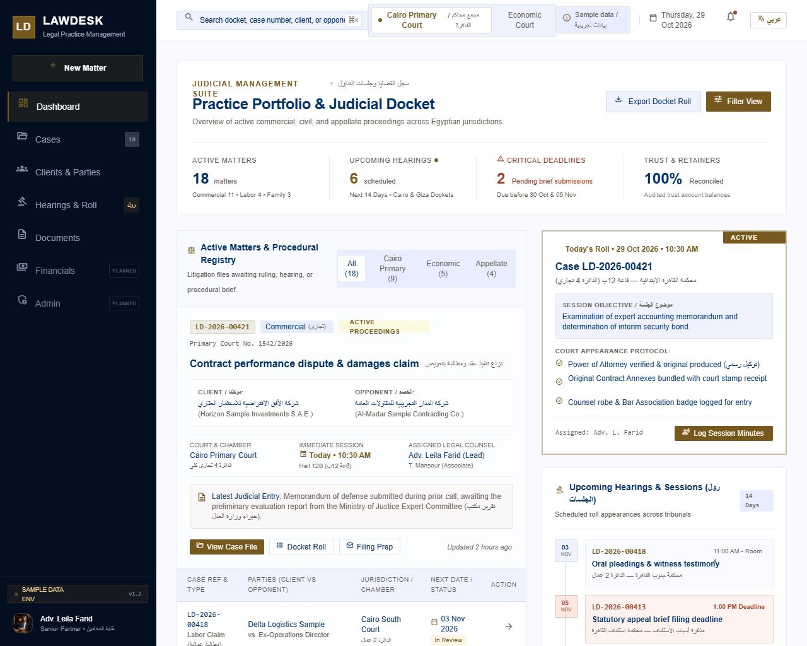
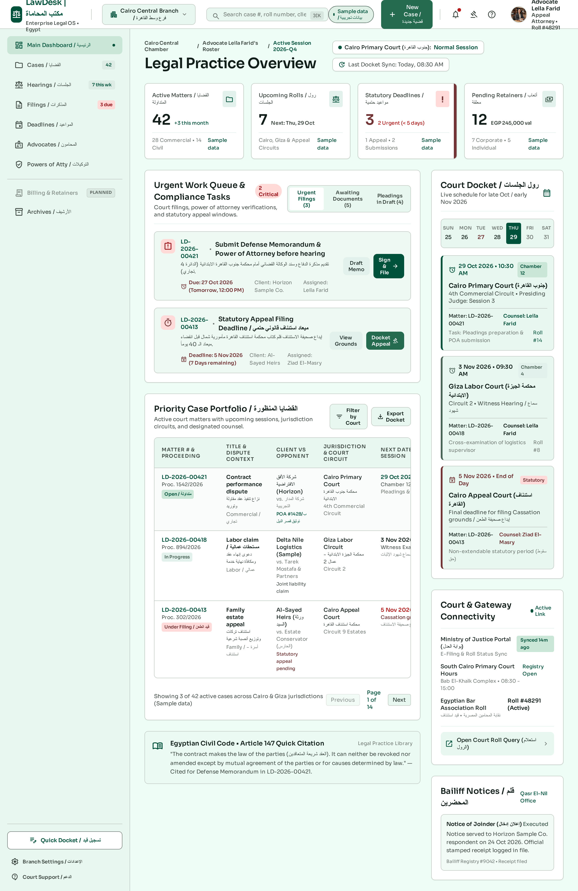
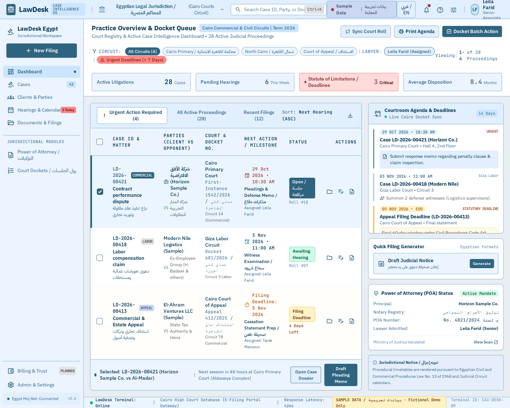

# LawDesk — independent Stitch design comparison

**Baseline:** `origin/develop` at `81d9d03acdc6f8d6e3d11475342ac10e49f79a32` (24 October 2026). **Scope:** visual concepts only. No application implementation was changed. All case and party examples in the designs are fictional.

## Product boundary used for the concepts

The current `develop` build has a sample-data dashboard, ready case list and case details, case parties and status/timeline, per-case judicial proceedings, courts, and permission-aware administration. The dashboard is explicitly a preview. Global hearings, documents, reports and experts are planned navigation entries; the product plan places hearings/documents in Phase 5 and reporting in Phase 6. The four designs show those areas as **roadmap concepts**, not working features. See [`navigation.ts`](../frontend/src/layout/navigation.ts), [`DashboardPage.tsx`](../frontend/src/pages/DashboardPage.tsx), and [`DELIVERY-PLAN.md`](../product/DELIVERY-PLAN.md).

## Screen inventory and project status

| Direction | Stitch project | Verified core screens | Verified Arabic RTL variant | Project Canvas currently lists | Design specification |
|---|---|---:|---:|---:|---|
| A — Legal Executive | [Open A](https://stitch.withgoogle.com/projects/17616592170830450346) | 6 desktop + 3 mobile | 1; extra revision reviewed and rejected | 9 core screens | [A DESIGN.md](concept-a/DESIGN.md) |
| B — Modern Workspace | [Open B](https://stitch.withgoogle.com/projects/2159660728911017526) | 6 desktop + 3 mobile | 1 | 6 desktop screens | [B DESIGN.md](concept-b/DESIGN.md) |
| C — Case Intelligence | [Open C](https://stitch.withgoogle.com/projects/2809941713949337888) | 6 desktop + 3 mobile | 1 | 6 desktop screens | [C DESIGN.md](concept-c/DESIGN.md) |
| D — Modern Chambers | [Open D](https://stitch.withgoogle.com/projects/2890116183553293246) | 6 desktop + 3 mobile | 1 | Dashboard only | [D DESIGN.md](concept-d/DESIGN.md) |

All 41 screen IDs in the evidence manifest, including the extra A revision, were confirmed individually with Stitch `get_screen`; each has a screenshot resource. The Canvas count is a separate `list_screens` result. Some screens do not appear on the project Canvas even though `get_screen` works. The project URLs use Stitch's documented project-link pattern and MCP-confirmed private project IDs; an unauthenticated browser cannot validate access. [STITCH-EVIDENCE.json](STITCH-EVIDENCE.json) holds every ID, screenshot resource, device type, local export, and Canvas status.

The six desktop topics per direction are Dashboard, Cases List, Case Details, Clients Management, Hearings/Calendar, and Document Management. The three mobile topics are Dashboard, Cases List, and Case Details. The extra Arabic screen is a mobile Cases List. These are separate screen resources, not a single montage.

## Representative screenshots

### A — Legal Executive

[Case details](screenshots/a-case-details.jpg) · [Arabic RTL cases list](screenshots/a-rtl-cases.png)

### B — Modern Workspace

[Case details](screenshots/b-case-details.png) · [Arabic RTL cases list](screenshots/b-rtl-cases.png)

### C — Case Intelligence

[Case details](screenshots/c-case-details.png) · [Arabic RTL cases list](screenshots/c-rtl-cases.png)

### D — Modern Chambers

[Case details](screenshots/d-case-details.png) · [Arabic RTL cases list](screenshots/d-rtl-cases.png)

## Design system comparison

| System element | A — Legal Executive | B — Modern Workspace | C — Case Intelligence | D — Modern Chambers |
|---|---|---|---|---|
| Atmosphere | Formal partner portfolio | Daily team workflow | Operations cockpit | Boutique editorial dossier |
| Core color | Navy `#101B2B`, brass `#8A6A2F` | Off-white `#F7F8F4`, forest `#246B50` | Slate `#E9EEF2`, steel `#376B88` | Charcoal `#272A29`, parchment `#F3EFE6`, brass `#876B3C` |
| Typography | Geist; IBM Plex Sans Arabic | Sora; Cairo/Noto Sans Arabic | IBM Plex Sans and mono numerals; IBM Plex Sans Arabic | DM Sans; Cairo/IBM Plex Sans Arabic |
| Navigation architecture | 248px formal sidebar | Compact contextual rail in specification; Stitch rendered a fuller sidebar on desktop | 210px sidebar plus filter pane and inspector | 104px wordmark rail and file subnavigation |
| Layout | 7:5 portfolio/agenda, case file split | 8:4 queue/calendar, 2:1 case workstream | 210/228/flexible/360 data workspace | 5:7 diary/dossier editorial split |
| Tables and forms | Ruled 48px records, formal labels | Spacious 52px rows and 48px inputs | Compact sticky-header grid, 40px rows with larger targets | Typographic rows, dossier fields, light rules |
| Case details | Portfolio masthead and procedural chronology | Context sidebar and task-oriented case facts; generated desktop masthead is too large | Dense proceedings and party workspace | Narrative hearing log beside party/file index |

These are structurally distinct. Stitch did not always follow the exact specification: B's generated desktop nav is wider than its 72px rail; C uses more card surfaces than the dense-table brief; D adds decorative judicial motifs that should be reduced.

## Visual review scores

Scores are **1–5 visual review judgments**, not usability-test results. The evidence is the exported dashboard, case-detail and RTL screenshots above plus direct inspection of mobile list/detail screens through Stitch. Screen behavior, keyboard use, actual color contrast, and HTML semantics still need hands-on validation before implementation.

| Criterion | A | B | C | D |
|---|---|---|---|---|
| Professional credibility | **4** — restrained navy/brass hierarchy, but trust/verified claims harm trust | **4** — calm enterprise layout; unsupported integrations in first dashboard | **4** — credible operations grid; fake portal status detracts | **4** — distinctive and polished; judicial motifs overused |
| Legal-domain suitability | **3** — proceedings and roles visible; invented legal steps and document validation | **3** — case/party roles clear; generated legal citations and hearing actions exceed product | **3** — court, stage and deadlines scan well; invented citations/registry sync | **3** — dossier structure strong; invented claim values and official status |
| Visual consistency | **4** — navy/brass and rule language hold across desktop/mobile | **3** — green palette holds; desktop nav and oversized details masthead diverge | **4** — steel grid and mono labels repeat; some card excess | **4** — charcoal/parchment/brass identity persists |
| Navigation clarity | **4** — explicit sections and current state | **3** — clear labels, but several planned areas look active | **4** — case, filter and inspector relationship is visible | **4** — narrow rail and file areas are distinct; some labels become small |
| Case-management usability | **3** — rich chronology but too much procedural detail above core facts | **2** — desktop details wastes the first viewport; mobile detail is much better | **4** — case facts, proceedings and parties visible together | **3** — hearing log useful, but critical facts compete with editorial blocks |
| Reading efficiency | **3** — dense bilingual lines in formal cards | **3** — list and mobile read well; desktop details masthead is inefficient | **3** — compact tables are quick for experts, demanding for occasional users | **3** — strong headings, but longer scanning paths and small metadata |
| Information density | **3** — balanced for partners, limited operational throughput | **3** — comfortable daily density | **5** — highest cross-case scan density | **3** — deliberate space favors context over throughput |
| Arabic RTL quality | **3** — direction correct; one case reference wraps and secondary Arabic is small | **4** — strongest Arabic flow, clear right alignment and readable case chips | **3** — strong Arabic case text, but English bottom nav and clipped filter chip | **3** — headline strong; bilingual CTA/date and clipped filter edge |
| Accessibility, visual only | **3** — hierarchy/focus potential good; small Arabic/meta and unverified contrast | **4** — comfortable targets and contrast impression; still requires measured tests | **2** — dense controls, pale blue text and small labels need work | **3** — readable primary text; brass/gray metadata may lack contrast |
| Mobile usability | **3** — list is structured; detail overlong and actions compete | **4** — clear list cards, details tabs, readable action sizes | **3** — usable filter sheet, but it obscures list and needs a close-state check | **3** — cards and dossier coherent; dense mixed-language content |
| React implementation feasibility | **4** — sidebar, grids, tables and timeline are conventional | **4** — simple components except correcting desktop case details | **3** — synchronized filters, inspector and responsive grid are more complex | **4** — layouts and typography feasible; document model is future work |

## Usability and accessibility findings

- **A:** Best executive scan and formal credibility. The Arabic list keeps its right-to-left reading order, but the `LD-2026-00413` badge wraps. A second Stitch revision kept the badge on one line but generated a 390px interface inside a wide blank canvas; it is not the preferred variant.
- **B:** Best everyday and mobile starting point. Its desktop Cases List has visible search and filters; its desktop Case Details screen needs a compact masthead and 2:1 work area. The Arabic variant has the clearest labels and visual direction. Some secondary text still needs contrast and font-size measurement.
- **C:** Best for high-volume case operations and deadlines. Dense table alignment is useful, but mobile filter-sheet content and narrow chips need checking at 320–390px. Never rely on color alone for urgency.
- **D:** Strongest brand distinction and case-file atmosphere. The timeline is memorable, but invented document and financial details are especially risky in a legal product. Use clear textual status and keep decorative legal imagery restrained.
- **All directions:** Stitch invented court connectivity, e-filing, verified documents, legal citations, claim values, counsel/party details and other facts despite repeated restrictions. Treat every generated line as placeholder content. Do not reuse legal assertions or status text without product and legal review. Consistent core case IDs were requested, but secondary facts drifted between projects.
- **Accessibility test plan:** Measure color contrast on every token and state; test 200% zoom, 320px width, keyboard order, visible focus, screen-reader names, table headers, empty/error states, reduced motion, and mixed Arabic/Latin number isolation. Screenshot review cannot prove these requirements.

## Recommendation

Use **B — Modern Workspace** as the primary direction for daily LawDesk work, after redesigning its desktop Case Details masthead and clearly marking roadmap destinations. Borrow **C's** filter/inspector pattern for high-volume case lists, **A's** partner-level portfolio summary, and **D's** restrained document/file organization. Use one shared content model and permission matrix so the hybrid remains coherent; never copy the generated legal claims or invented integrations.

This is a design recommendation, not a production readiness approval. Canvas linkage is incomplete for B/C/D despite confirmed screen resources; the full local screenshot gallery and evidence manifest preserve the reviewable result.
