# LD-DOC-03 — مخطط البيانات والعلاقات ومقترح الترحيل

الحالة: **للاعتماد قبل أي ترحيل**. كل التغييرات إضافية (Flyway، أعمدة nullable، جداول جديدة). لا حذف ولا إعادة تسمية للجداول الحالية.
أرقام الترحيل في النطاق V5xx..V9xx؛ سياسة `tools/contracts.py` تتطلب تسجيل نطاقات الترحيل لكل حزمة عمل قبل أول PR.
اصطلاحات ثابتة: المفاتيح `uuid`، `version bigint` للقفل المتفائل، `created_at/by` و`updated_at/by`، المبالغ `numeric(15,3)` بالدينار، الأحداث الزمنية `timestamptz`
والتواريخ القانونية `date`، والتوقيت المعروض Asia/Kuwait. الكتابة الفعلية على القضية تمر عبر `CaseService.recordEvent` وسياسة الوصول الموحدة.

## 1. الخريطة العامة

```mermaid
erDiagram
  legal_case ||--o{ proceeding : "درجات"
  legal_case ||--o{ case_party : "أطراف"
  party ||--o{ case_party : ""
  legal_case ||--o{ case_org_involvement : "جهات معنية"
  org_unit ||--o{ case_org_involvement : ""
  org_unit ||--o{ org_unit : "الأب"
  legal_case ||--o{ claim : "طلبات"
  claim ||--o{ claim_revision : "نسخ"
  proceeding ||--o{ hearing : "جلسات"
  hearing ||--o| hearing : "تأجيل إلى"
  proceeding ||--o{ judgment : "أحكام"
  judgment ||--o{ claim_result : "نتيجة كل طلب"
  claim ||--o{ claim_result : ""
  legal_case ||--o{ defense : "دفوع"
  defense ||--o{ defense_position : "موقف المحكمة لكل حكم"
  judgment ||--o{ defense_position : ""
  proceeding ||--o{ defense_assertion : "التمسك بالدفع بكل درجة"
  defense ||--o{ defense_assertion : ""
  legal_case ||--o{ case_fact : "وقائع"
  legal_case ||--o{ evidence_item : "أدلة"
  evidence_item ||--o{ evidence_link : "ربط"
  case_fact ||--o{ evidence_link : ""
  defense ||--o{ evidence_link : ""
  claim ||--o{ evidence_link : ""
  legal_case ||--o{ info_request : "طلبات إفادة"
  info_request ||--o{ info_reply : "ردود"
  info_request ||--o{ info_follow_up : "متابعات"
  legal_case ||--o{ risk_assessment : "تقييمات"
  risk_assessment ||--o{ risk_remediation : "خطة"
  judgment ||--o{ deadline : "مواعيد"
  judgment ||--o{ enforcement_file : "تنفيذ"
  legal_case ||--o{ case_link : "ارتباط"
  legal_case ||--o{ case_document : "مستندات"
  library_judgment ||--o{ library_principle : "مبادئ"
  legal_case ||--o{ case_precedent_link : ""
  library_judgment ||--o{ case_precedent_link : ""
  legal_case ||--o{ task : "مهام"
  legal_case ||--o{ settlement : "تسويات"
  legal_case ||--o{ directive : "تكليفات"
```

## 2. الجداول الجديدة والموسَّعة، حسب حزمة العمل

### WP1 — النواة (القضية، الأطراف، الجهات، الوصول)

| الجدول | الأعمدة الجوهرية | ملاحظات |
|--------|------------------|----------|
| `legal_case` (توسيع) | `chamber` (الدائرة، على القضية)، `received_on date` (ورود الإدارة)، `referring_unit_id` (جهة الإحالة)، `facts text`، `claimed_amount numeric(15,3)`، `importance` (LOW/NORMAL/HIGH/CRITICAL)، `confidentiality` (NORMAL/RESTRICTED)، `case_type` يتسع بـ CONSTITUTIONAL وOTHER | الأعمدة nullable؛ «غير محدد» حيث لا بيانات؛ لا تعبئة مخترعة |
| `proceeding` (توسيع) | `stage` يتسع بـ CONSTITUTIONAL وENFORCEMENT وGRIEVANCE، `chamber`، `status` | قرار D2 |
| `party` (توسيع) | `civil_or_establishment_no` (يستعمل `national_id`/`registration_no` الحاليين)، `confidential bool`، `notes` | تسمية فقط، لا تغيير في القيم |
| `party_counsel` | `party_id`، `case_id` اختياري، `name`، `kind` (LAWYER/AGENT)، `phone`، `email`، `notes` | المحامي أو الوكيل |
| `org_unit` | `id`، `parent_id`، `level` (SECTOR/DEPARTMENT/SECTION)، `name_ar`، `name_en`، `active`، `valid_from`، `valid_to` | شجرة قابلة للإدارة |
| `case_org_involvement` | `case_id`، `org_unit_id`، `is_primary`، `contact_name`، `contact_info`، `referral_date`، `requested_from_unit text`، `notes`، **`sector_name_snapshot`، `department_name_snapshot`، `section_name_snapshot`** | اللقطة تحفظ الهيكل وقت التسجيل؛ إعادة تسمية الوحدة لا تغيّر اللقطة |
| `access_scope` | `subject_type` (USER/ROLE)، `subject_id`، `scope_type` (ALL/ORG_UNIT/CASE_TYPE/OWN)، `scope_ref` | قرار D3 |
| `case_grant` | `case_id`، `user_id`، `level` (VIEW/CONTRIBUTE)، `reason`، `granted_by`, `expires_at` | منح صريح لقضية |
| `case_duplicate_hint` | `case_id`، `other_case_id`، `kind` (EXACT/SIMILAR)، `reasons jsonb`، `reviewed_by`، `decision` (DISTINCT/LINKED/DUPLICATE_CONFIRMED) | لا دمج ولا حذف تلقائي |
| `audit_event` | يبقى؛ أنواع أحداث جديدة | لا تعديل ولا حذف |

### WP2 — الطلبات والأحكام والدفوع والأدلة

| الجدول | الأعمدة الجوهرية |
|--------|------------------|
| `claim` | `case_id`، `seq` (فريد داخل القضية)، `text`، `kind` (PRIMARY/ALTERNATIVE/INCIDENTAL/ANCILLARY/URGENT/OTHER)، `submitted_by_party_id`، `submitted_on`، `stage_id`→proceeding، `source_document_id`، `status` (STANDING/AMENDED/WAIVED/ABANDONED/OTHER)، `notes`، `version` |
| `claim_revision` | `claim_id`، `rev`، `text`، `kind`، `status`، `changed_by`، `changed_at`، `reason` — لقطة كاملة عند كل تعديل |
| `judgment` (توسيع) | `chamber`، `judgment_type`→lookup، `operative_text`، `reasons`، `nature`→lookup، `costs_amount`، `lawyer_fees_amount`، `appealable`، `notified_on`، `appeal_deadline_id`، `status`، `copy_document_id`؛ `summary` و`final` يبقيان |
| `claim_result` | `judgment_id`، `claim_id`، `result` (ACCEPTED/PARTIAL/REJECTED/INADMISSIBLE/NO_JURISDICTION/REFERRED/EXTINGUISHED/WAIVER_RECORDED/ABANDONMENT_RECORDED/NOT_DECIDED/DEFERRED/OTHER)، `operative`، `reasons`، `awarded_amount`، `notes`، فريد `(judgment_id, claim_id)` — **كل حكم نتائجه مستقلة، فلا استبدال لنتائج الدرجات السابقة** |
| `defense` | `case_id`، `seq`، `title`، `kind` (FORMAL/PROCEDURAL/SUBSTANTIVE/OTHER)، `argument`، `legal_basis`، `facts`، `texts`، `memo_document_id`، `raised_on`، `raised_stage_id`، `prepared_by`، `notes`، `template_id` اختياري |
| `defense_assertion` | `defense_id`، `proceeding_id`، `status` (RAISED/RE_ASSERTED/NOT_ASSERTED)، `on_date`، `memo_document_id` — التتبع بين الدرجات |
| `defense_position` | `defense_id`، `judgment_id`، `position` (ACCEPTED/REJECTED/PARTIAL/NOT_ADDRESSED/MOOT/DEFERRED/OTHER)، `reasons`، `operative`، فريد `(defense_id, judgment_id)` |
| `defense_precedent` | `defense_id`، `library_judgment_id` |
| `defense_template` | `title`، `kind`، `text`، `legal_basis`، `status` (DRAFT/REVIEWED/APPROVED)، `reviewed_by` — لا ينسخ آليًا |
| `case_fact` | `case_id`، `seq`، `text`، `date` |
| `evidence_item` | `case_id`، `document_id` اختياري، `name`، `doc_type`، `issued_on`، `issuer`، `received_on`، `source`، `role` (SUPPORTING/OPPONENT/DISPUTED/REQUIRED/UNAVAILABLE/SUPPLEMENTARY)، `importance` (LOW/MEDIUM/HIGH/DECISIVE)، `submitted_to_court bool`، `submitted_on`، `submitted_in` (مذكرة/جلسة)، `opponent_response`، `court_position`، `notes` |
| `evidence_link` | `evidence_id` + واحد من (`fact_id`/`defense_id`/`claim_id`) — علاقات متعددة |
| `gap_followup` | `evidence_id`، `task_id`، `info_request_id` — ربط النواقص بمهمة وطلب إفادة |

### WP3 — الجلسات والإدارات والمخاطر والارتباط والملخص

| الجدول | الأعمدة الجوهرية |
|--------|------------------|
| `hearing` (توسيع) | `hearing_time time`، `chamber`، `kind` (COURT/EXPERT/INVESTIGATION/OTHER)، `judge_or_expert`، `responsible_member_id`، `attendees text`، `proceedings_summary`، `opponents_requests`، `required_action`، `adjournment_reason`، `no_next_date bool`، `no_next_date_reason`، `follow_up_flag` |
| `info_request` | `case_id`، `request_no` (يولده النظام)، `unit_id`، `subject`، `details`، `required_documents`، `drafted_on`، `sent_on`، `letter_no`، `letter_date`، `due_on`، `responsible_member_id`، `addressee`، `status` (DRAFT/PENDING_APPROVAL/SENT/AWAITING/PARTIAL/INCOMPLETE/COMPLETE/OVERDUE/CLOSED)، `delay_reason`، `linked_fact_id`/`linked_defense_id` |
| `info_reply` | `request_id`، `received_on`، `completeness` (PARTIAL/INCOMPLETE/COMPLETE)، `summary`، `document_id` (يؤرشف في ملف القضية)، `linked_*` |
| `info_follow_up` | `request_id`، `kind` (REMINDER/RE_ADDRESS/ESCALATION)، `on_date`، `by`، `note`، `escalated_to` |
| `risk_assessment` | `case_id`، `version_no`، 10 عناصر تقييم (كل عنصر قيمة + سبب)، `level` (LOW/MEDIUM/HIGH/VERY_HIGH)، `level_reasons`، `potential_loss numeric(15,3)`، `trigger` (NEW_DOCUMENT/JUDGMENT/DECISION/POSITION_CHANGE/PERIODIC)، `assessed_by`، `assessed_at` — **لا يُعدَّل، يُضاف إصدار** |
| `risk_remediation` | `assessment_id`، `cause`، `action`، `documents`، `defenses`، `unit_to_address`، `owner_id`، `target_date`، `status` |
| `case_link` | `case_id`، `other_case_id`، `kind` (SUBJECT_LINK/JOINDER_REQUEST/JOINDER_DECISION/REFERRAL)، `reason`، `requested_by`، `requested_on`، `court_decision bool`، `decision_date`، `operative`، `decision_document_id`، `status`؛ مؤشر معكوس يُعرض في الملفين؛ لا إغلاق متسلسل |
| `case_event` (توسيع) | روابط `ref_type/ref_id` للانتقال المباشر، `is_future`، `corrects_event_id` للتعديلات التاريخية |

### WP4–WP10

| الحزمة | الجداول |
|--------|----------|
| WP4 المواعيد | `deadline` (`source_type/id`، `starts_on`، `period_days` أو `rule_id`، `due_on`، `action`، `owner_id`، `status`، `completed_on`، `proof_document_id`، `calc_status` PROPOSED/APPROVED/MANUAL، `approved_by/at`)، `deadline_rule` (`code`، `label`، `period_days`، `count_method` CALENDAR/WORKING، `legal_source` إلزامي، `status` DRAFT/APPROVED، `effective_from`) — **فارغة حتى يعتمد المالك**، `official_holiday` |
| WP5 التنفيذ والأرشيف والمراسلات | `enforcement_file`/`enforcement_action`، `document_version`، `document_category`، `document_link`، `document_text` (OCR)، `legal_document` (نوع، حالة DRAFT/IN_REVIEW/APPROVED/SENT/ARCHIVED، `sent_recorded` مقابل `sent_via_integration`) |
| WP6 المهام والتقويم والتنبيهات | `task` (حالات سبع، `starts_on`، `instructions`، `delay_reason`)، `task_history`، `calendar_event` (مشتق من الجلسات والمهام والمواعيد)، `notification` (`type` من 11، `dedupe_key` فريد، `record_ref`) |
| WP7 المكتبة | `library_judgment`، `library_principle`، `case_precedent_link`، `library_judgment_relation` (APPEALED/UPHELD/MODIFIED/OVERTURNED/LATER/DEPARTED_FROM مع المصدر)، قوائم تصنيف |
| WP8 اللوحة والتقارير | لا جداول؛ خدمات تعريف مؤشر موحد تستخدمها اللوحة والقوائم والتصدير |
| WP9 | `settlement`، `directive`، `form_template`/`form_template_version`، فهرس بحث |
| WP10 المساعد | `assistant_session`، `assistant_query_log`، `assistant_output` (مسودة غير نهائية)، `ai_provider_config` (فارغ) |

القوائم المعيارية (`lookup_value`): نوع الحكم، صفة الحكم، أنواع المراسلات، تصنيفات المكتبة. قيم ابتدائية مقترحة تُعلَّم «تحتاج اعتماد المالك».

## 3. ترحيل البيانات الحالية (دون فقد)

| الموجود | الإجراء |
|---------|---------|
| قضايا بلا `automated_no`/موقف/مختص/أثر مالي | تبقى «غير محدد» (لا تخمين) وتظهر في قائمة «تحتاج استكمالًا» |
| `judgment.outcome` + `summary` | يبقيان؛ `summary` يُنسخ إلى `operative_text` فقط عند طلب المستخدم إكمال الحكم، لا آليًا |
| `judgment` بلا نتائج طلبات | تظهر «النتائج التفصيلية غير مسجلة» ولا تُولَّد نتائج |
| `hearing.purpose` | يبقى؛ `kind` = COURT افتراضيًا للجلسات الحالية فقط حيث يتفق (قيمة محافظة قابلة للتصحيح) |
| `task.status` OPEN/DONE | `OPEN→NEW`، `DONE→COMPLETED`، `CANCELLED`، `IN_PROGRESS` ثابتة؛ جدول مطابقة موثق وقابل للرجوع |
| `case_document` PDF | يبقى؛ يُنشأ `document_version` v1 لكل مستند بنفس المحتوى والمعرّف |
| `party.national_id` | قيمة وحقل كما هما؛ تتغير التسمية فقط |
| أدوار وصلاحيات | تبقى؛ صلاحيات جديدة تُمنح افتراضيًا للأدوار مثل الحالية بترحيل إضافي (نمط V190)، والأدوار الأربعة الجديدة تُنشأ بلا مستخدمين |
| الوصول | `access_scope` الافتراضي: ALL للأدوار الحالية، ما يحفظ الرؤية الحالية إلى قرار D3 |

## 4. النسخ الاحتياطي والاسترجاع والرجوع

1. قبل كل حزمة تحتوي ترحيلًا: النسخ الاحتياطي عبر مسار النشر الحالي (`LAWDESK_BACKUP_DIR`)، وتسجيل اسم النسخة في تقرير الحزمة.
2. الترحيلات إضافية فقط، فالرجوع = نشر SHA السابق مع بقاء الأعمدة الجديدة غير مستعملة (يعمل بلا حذف).
3. اختبار الترحيل: قاعدة بيانات اختبار تُحمَّل ببيانات تمثل UAT الحالية، يطبَّق عليها الترحيل، وتُقارن أعداد الصفوف والمفاتيح قبل/بعد، ثم تُستعاد النسخة الاحتياطية ويُتحقق من تطابقها، وتُحفظ السجلات في `docs/evidence/`.
4. لا ترحيل مدمِّر (drop/rename) إلا بحزمة منفصلة بعد استقرار نسختين على الأقل.

## 5. الأداء والتوسع

فهارس على كل مفتاح أجنبي وعلى `(case_id, seq)` و`(status, due_on)` و`dedupe_key`؛ ترقيم الصفحات في كل قائمة؛ البحث الموحد عبر
PostgreSQL FTS مع تطبيع عربي (همزات/تاء مربوطة/تشكيل) و`pg_trgm` للتشابه (D7). حد أداء مقترح: قائمة القضايا والبحث < 500 مللي ثانية على 50 ألف قضية و500 ألف سجل فرعي، يُقاس بحزمة أداء المرحلة 8.
