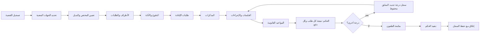
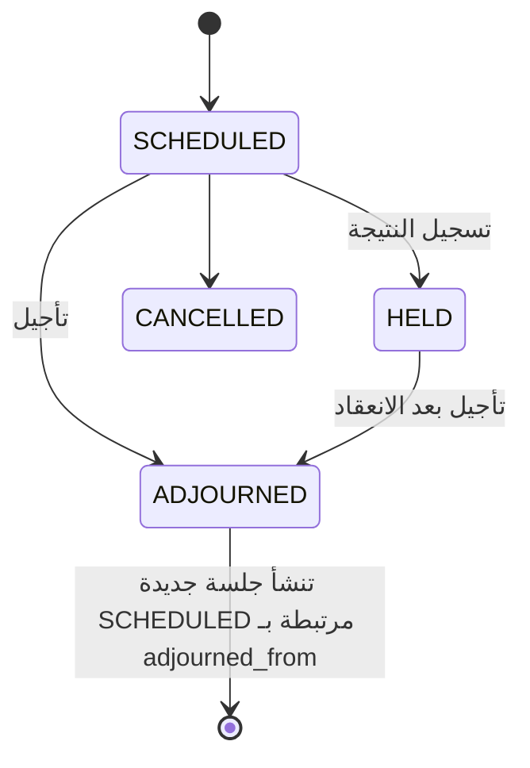
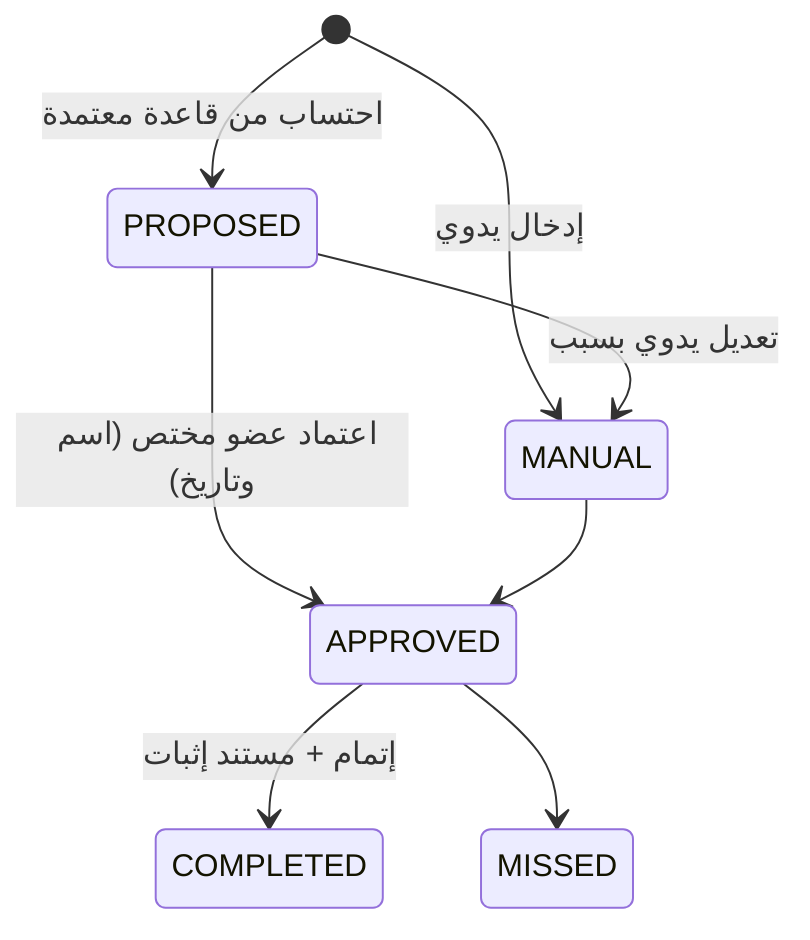

# LD-DOC-05 — تدفقات العمل الأساسية

الحالات ثابتة بنص الوثيقة؛ الانتقالات مرنة (القسم 33): لا ترتيب جامد يمنع حالة مشروعة، لكن كل انتقال يُسجَّل وبعضها يستلزم تحققًا.

## 1. دورة حياة القضية

قواعد: الخطوات ليست شروطًا لبعضها. الإغلاق يفحص (تحذير بسبب لا منع): جلسات مستقبلية، مواعيد قائمة، تنفيذ غير مكتمل، مهام مفتوحة، طلبات إفادة معلقة، تسويات غير مكتملة الموافقة. يُسجَّل سبب الإغلاق، ولا يُحذف أي سجل. الجلسات السابقة تبقى ظاهرة.

## 2. الجلسة والتأجيل

- التأجيل لا يعدّل الجلسة السابقة سوى حالتها وسببها؛ يُنشأ سجل مستقل للتالية.
- إن لم يحدَّد موعد: `no_next_date=true` مع السبب، وتدخل القضية قائمة «المتابعة» وتصدر تنبيه.
- جلسة انعقد ميعادها دون نتيجة مسجلة تظهر في التنبيهات.

## 3. الطلب ونتائج الأحكام

1. إضافة طلب: رقم تسلسلي، نص، نوع، مقدم، مرحلة، مستند.
2. تعديل طلب: لقطة النص السابق في `claim_revision` مع المستخدم والتاريخ والسبب؛ الحالة (قائم/معدل/متنازل/متروك/أخرى).
3. تسجيل حكم: النموذج يعرض **كل الطلبات القائمة وقت الحكم** فيحدد المستخدم نتيجة كل طلب (12 نتيجة)، المنطوق والأسباب والمبلغ والملاحظات، ويعرض كل **الدفوع المثارة** فيحدد موقف المحكمة (7 مواقف).
4. الدرجة التالية: سجل جديد للدرجة؛ تعرض الطلبات والدفوع نتائج كل درجة جنبًا إلى جنب، دون استبدال.
5. إحصاءات النتائج تحسب من `claim_result` بدلًا من تخزين ثانٍ.

## 4. الميعاد القانوني

لا تُعرَض مدة محسوبة كموعد معتمد؛ تظهر «مقترح بانتظار الاعتماد». لا توجد قواعد مدد في النظام قبل أن يعتمد المالك قواعد موثقة المصدر (D6).
التنبيهات المسبقة بحسب إعداد لكل نوع ميعاد.

## 5. طلب الإفادة

`DRAFT → PENDING_APPROVAL → SENT → AWAITING → PARTIAL | INCOMPLETE | COMPLETE → CLOSED`، و`OVERDUE` مشتقة من الموعد المحدد بلا رد مكتمل.
ردود متعددة لكل طلب؛ كل رد يحمل اكتماله وتاريخه ومرفقاته ويؤرشف تلقائيًا ويُربط بالواقعة/الدفع. التصعيد: تذكير للعضو قبل الموعد، تنبيه للمسؤول المباشر عند التأخر، إعادة مخاطبة بسجل متابعات، سبب التأخير. المتأخر لا يُغلق تلقائيًا.

## 6. المخاطر

إصدار جديد من التقييم عند: مستند جديد، حكم، قرار، تغير موقف، أو يدويًا. الإصدارات القديمة لا تتغير. المستوى مرتفع/مرتفع جدًا يفرض خطة معالجة ويُصدر تنبيهًا. التقييم أداة مساعدة لا توقعًا قضائيًا (نص ثابت في الواجهة والتقرير).

## 7. المذكرة والمراسلة

`DRAFT → IN_REVIEW → APPROVED → SENT → ARCHIVED`. «SENT» تسجيل يدوي بأن المستند أُرسل (طريقة وتاريخ ومرجع)، ولا تعني إرسالًا عبر نظام خارجي؛ حقل `sent_via_integration` منفصل يبقى false حتى يوجد تكامل فعلي.

## 8. المكتبة والسوابق

إدخال حكم (مصدر وبيانات تحقق إلزامية) ← استخلاص مبدأ أو أكثر ← ربط بالقضايا مع سبب الاستفادة ← اقتراح غير توليدي (تطابق موضوع/نص قانوني/نوع دفع/طلب بترتيب موثق) يعرض أوجه التشابه والاختلاف والمصدر ← تتبع الحجية (نهائي، طعن، تأييد، تعديل، إلغاء، عدول) بمصدر موثوق. عدد الأحكام ومصادرها وتواريخها تُعرض دائمًا؛ لا وصف «اتجاه مستقر» آلي.

## 9. التسوية

التسجيل لا يغير حالة القضية. اكتمال الموافقات المطلوبة يسمح للمختص باقتراح إغلاق أو إنهاء الطلبات المعنية، والقرار يبقى يدويًا وبسبب.
