# Modern Chambers — owner visual review

**Approval gate:** review the corrected Dashboard and Reports before either Phase 7 PR is merged or deployed. These screenshots are actual Chromium renders of LawDesk with fictional, contract-shaped local API responses. They show the interface; they are not UAT data or independent QA acceptance. Open any image for its full resolution.

The [approved Google Stitch project](https://stitch.withgoogle.com/projects/2890116183553293246) has one saved desktop Dashboard screen (`51490074816b4a16a0ebfbc19f35a506`, 2560 × 2048). The first image below is that actual saved screen. Cases, operations, reports and mobile layouts apply its visual system to the real LawDesk v1 workflows; they are interpretations because no approved Stitch screens exist for them.

## 1. Approved source and corrected live Dashboard

| Approved Stitch Dashboard | Corrected LawDesk Dashboard, English desktop |
| --- | --- |
| <a href="reference/stitch-dashboard.png">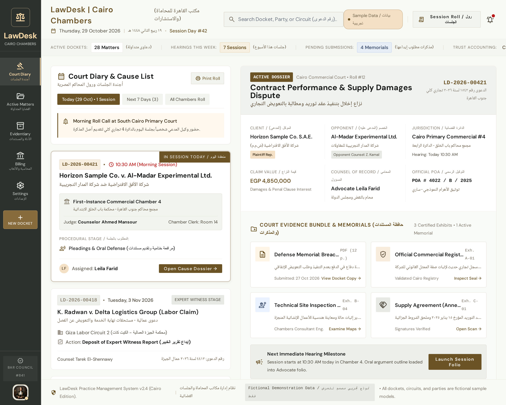</a> | <a href="screenshots/correction/dashboard-en-1366.png">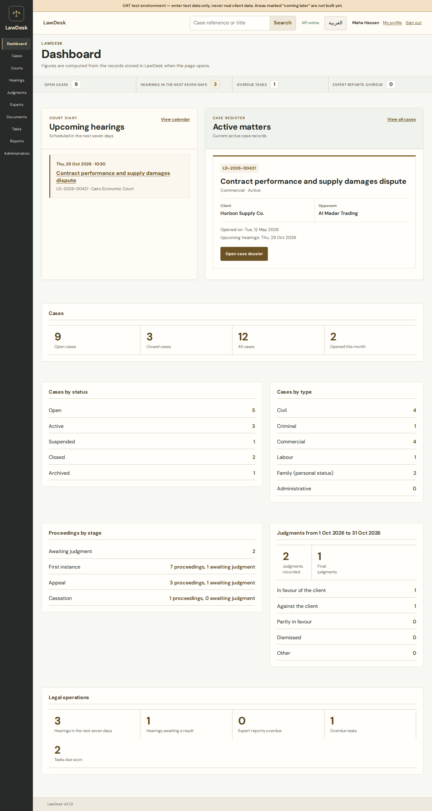</a> |

[Approved source full size](reference/stitch-dashboard.png) · [Corrected Dashboard full size](screenshots/correction/dashboard-en-1366.png) · [Corrected Arabic mobile Dashboard](screenshots/correction/dashboard-ar-375.png) · [Before correction](screenshots/after/dashboard-stitch-en-1366.png)

The correction narrows the Dashboard rail to Stitch's 104 px, adds a quiet heading band and compact horizontal metric strip, then makes the Court Diary and active dossier the dominant 5:7 composition. The lead dossier now shows client and opponent names when the existing case-party API returns them, plus the actual next hearing when it belongs to that case. Typography, muted green-ivory surface, brass rules and restrained borders are closer to the source. The lower statistical panels remain because LawDesk v1 already provides those real figures. [Responsive and axe results](screenshots/correction/dashboard-matrix.json).

The app uses real dashboard figures, scheduled-hearing, active-case and case-party APIs with their existing permission gates. Stitch shows trust accounting, print roll and richer case facts that LawDesk v1 cannot supply; those actions were not simulated. The original Stitch screen is a desktop composition, so the Arabic mobile layout is an adaptation, not a pixel copy.

## 2. Reports corrected to the same visual language

All five report routes now use the Dashboard's muted ivory and brass system: one heading treatment, a paper report body, a lighter filter area, ruled metric summaries, readable table headers and rows, aligned pagination, consistent empty states, and permission-gated export controls. All 40 loaded report states (5 routes × 2 languages × 4 widths) had no page error or document-level overflow; the 10 representative desktop/mobile states had no axe WCAG 2/2.1 A/AA violation. No query, metric, permission or export endpoint was changed.

| Case inventory | Judgments | Hearings |
| --- | --- | --- |
| <a href="screenshots/correction/inventory-en-1366.png">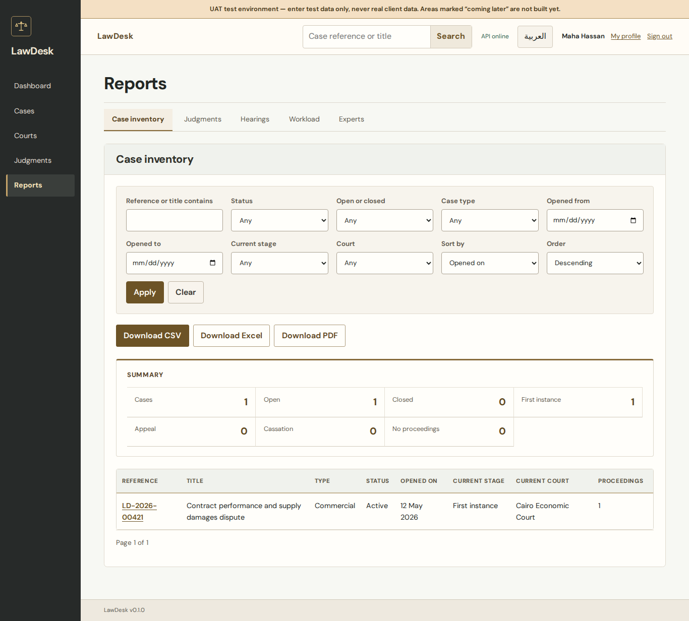</a> | <a href="screenshots/correction/judgments-en-1366.png">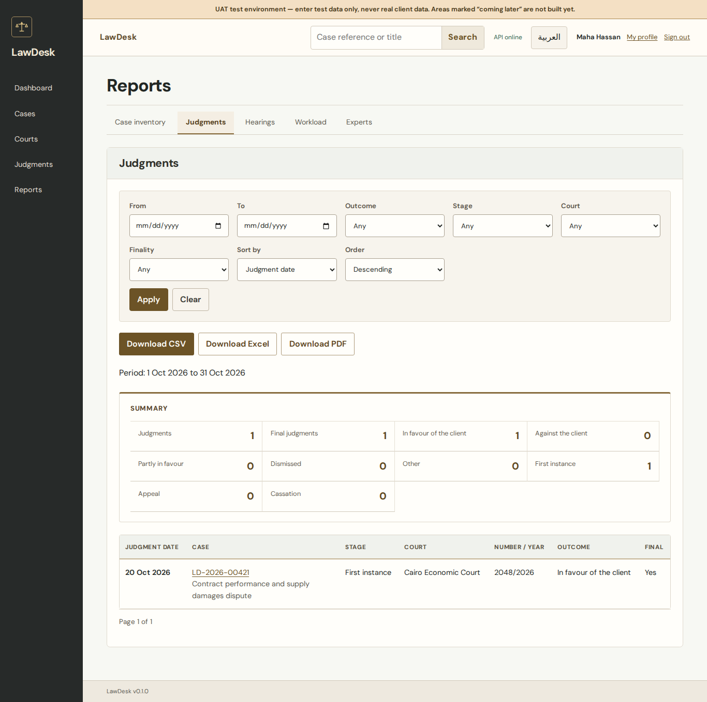</a> | <a href="screenshots/correction/hearings-en-1366.png">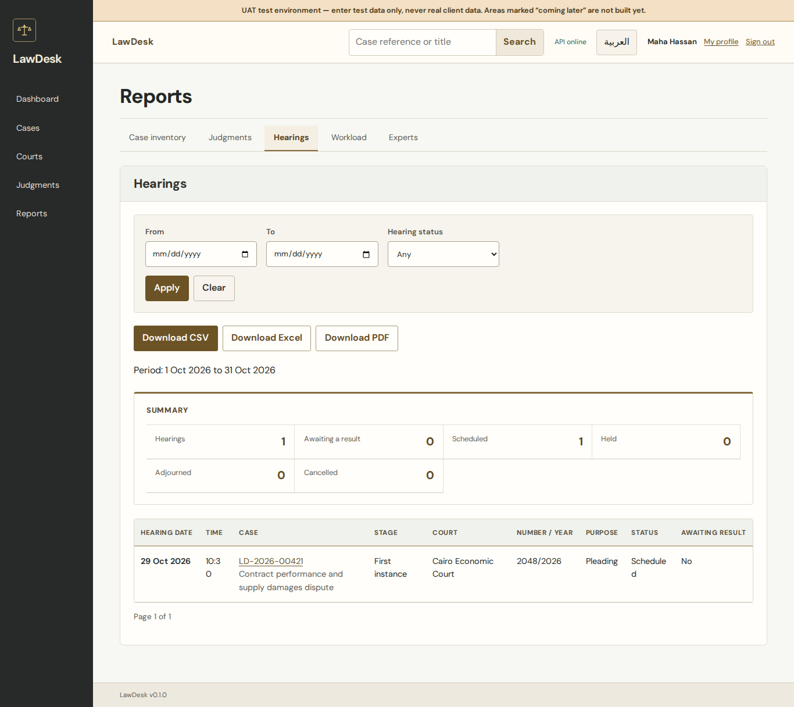</a> |

| Workload | Experts | Arabic mobile report |
| --- | --- | --- |
| <a href="screenshots/correction/workload-en-1366.png">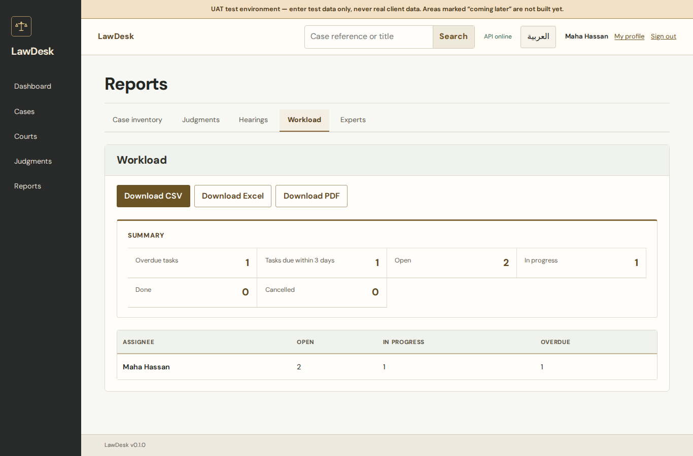</a> | <a href="screenshots/correction/experts-en-1366.png">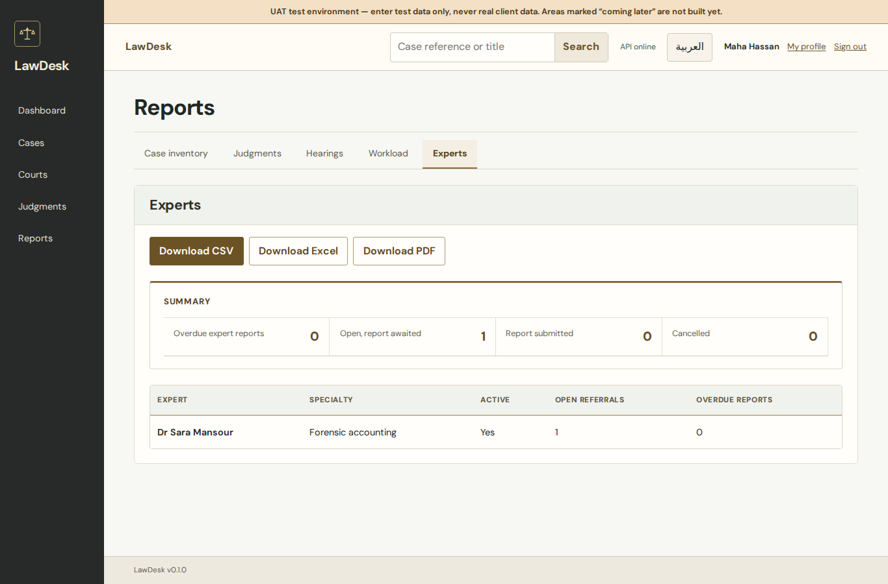</a> | <a href="screenshots/correction/inventory-ar-375.png">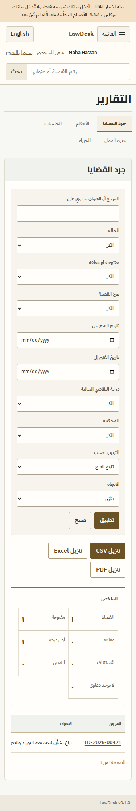</a> |

[Arabic judgments](screenshots/correction/judgments-ar-375.png) · [Arabic hearings](screenshots/correction/hearings-ar-375.png) · [Arabic workload](screenshots/correction/workload-ar-375.png) · [Arabic experts](screenshots/correction/experts-ar-375.png) · [Report responsive and accessibility results](screenshots/correction/reports-matrix.json).

## 3. Cases and dossier

| Cases, English desktop | Cases, Arabic mobile | Case dossier, English desktop |
| --- | --- | --- |
| <a href="screenshots/after/cases-current-en-1366.png">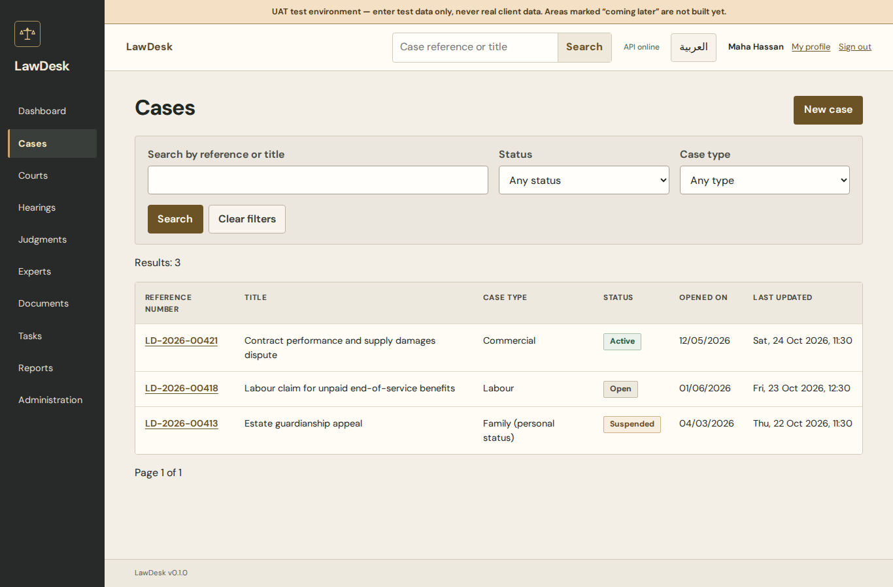</a> | <a href="screenshots/after/cases-current-ar-375.png">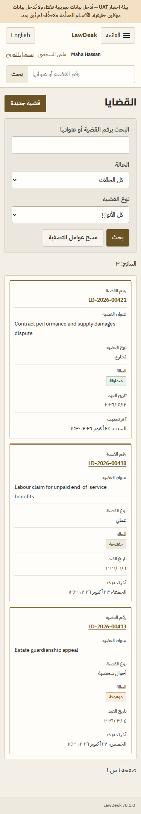</a> | <a href="screenshots/after/case-details-current-en-1366.png">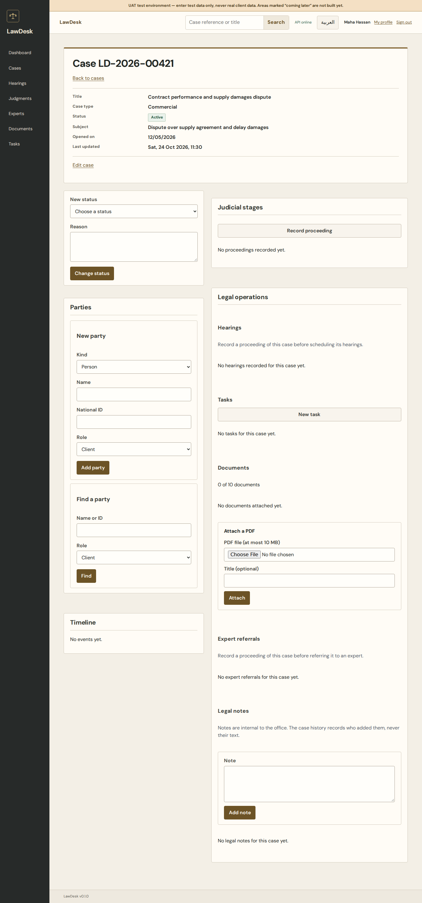</a> |

[Cases desktop](screenshots/after/cases-current-en-1366.png) · [Cases Arabic mobile](screenshots/after/cases-current-ar-375.png) · [Dossier desktop](screenshots/after/case-details-current-en-1366.png) · [Dossier Arabic mobile](screenshots/after/case-details-current-ar-375.png)

## 4. Legal operations

| Tasks, English desktop | Tasks, Arabic mobile |
| --- | --- |
| <a href="screenshots/review/tasks-en-1366.png">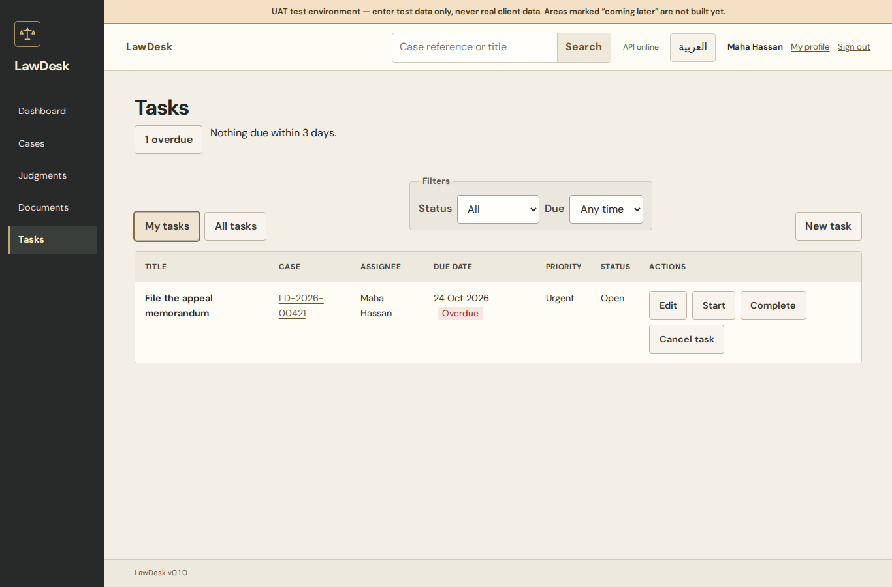</a> | <a href="screenshots/review/tasks-ar-375.png">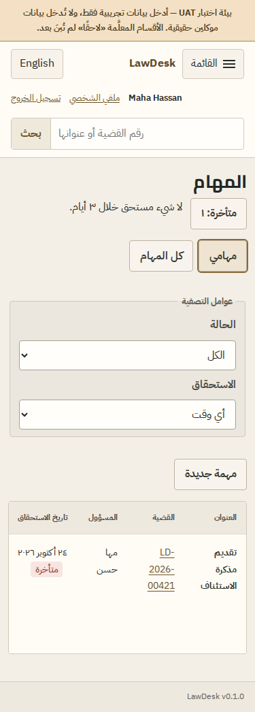</a> |

| Documents, English desktop | Documents, Arabic mobile |
| --- | --- |
| <a href="screenshots/review/documents-en-1366.png">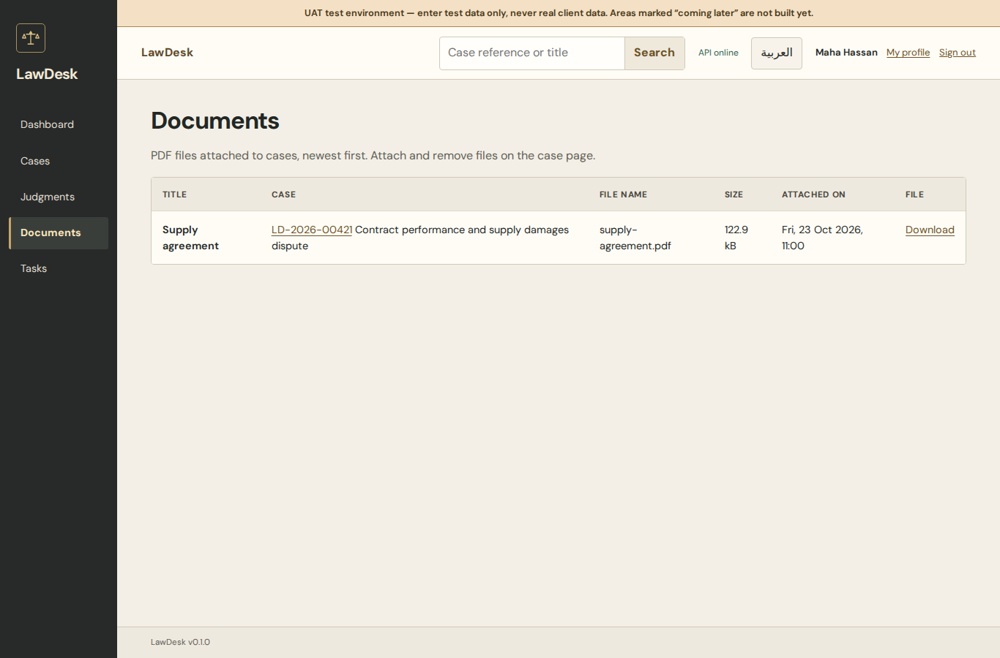</a> | <a href="screenshots/review/documents-ar-375.png">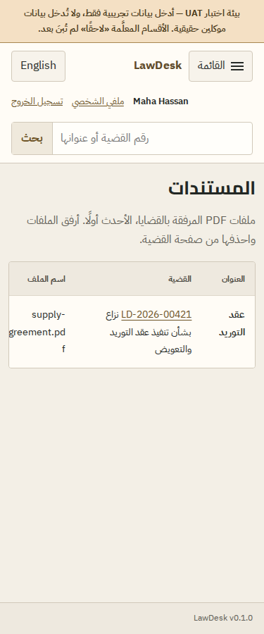</a> |

[Tasks desktop](screenshots/review/tasks-en-1366.png) · [Tasks Arabic mobile](screenshots/review/tasks-ar-375.png) · [Documents desktop](screenshots/review/documents-en-1366.png) · [Documents Arabic mobile](screenshots/review/documents-ar-375.png). The 16 populated task/document states at 320/375/768/1366 px in both languages had no page errors, document-level overflow or axe WCAG 2/2.1 A/AA violations; see [results](screenshots/review/operations-matrix.json).

## 5. Previous Reports baseline

| Case inventory, English desktop | Case inventory, Arabic mobile |
| --- | --- |
| <a href="screenshots/after/inventory-current-en-1366.png">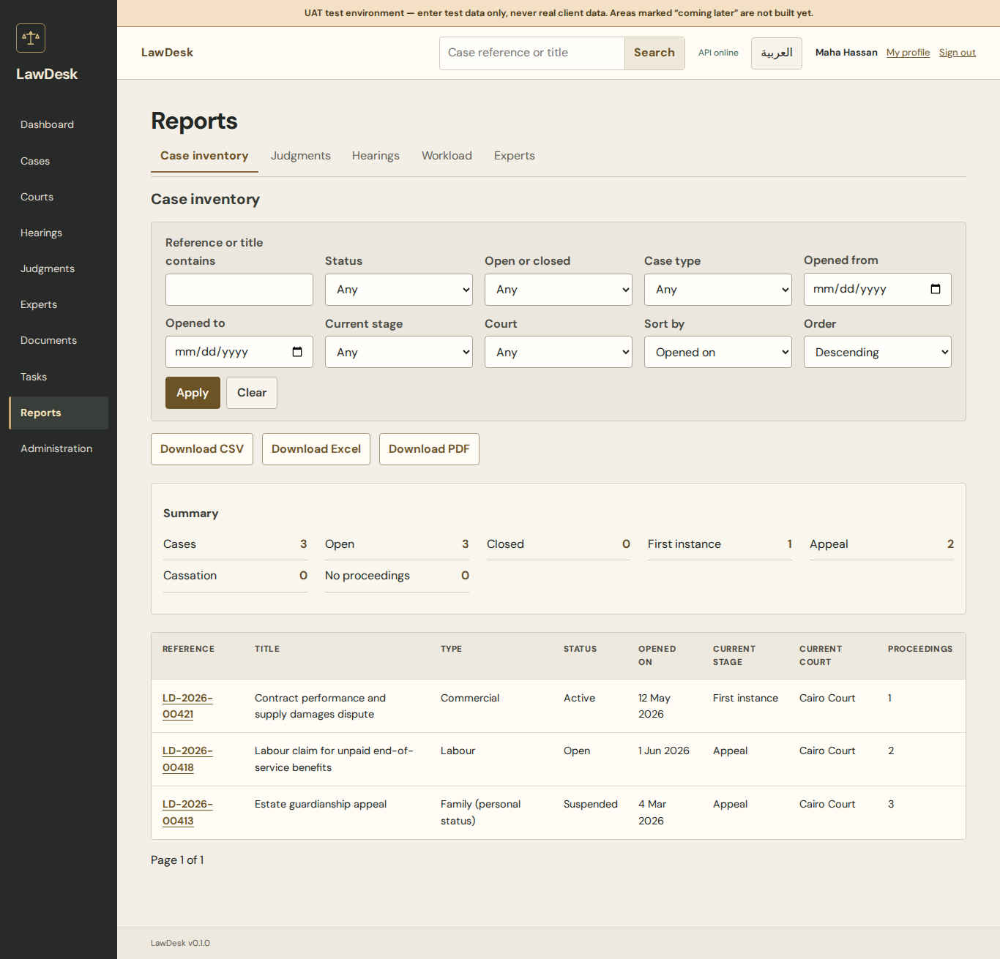</a> | <a href="screenshots/after/inventory-current-ar-320.png">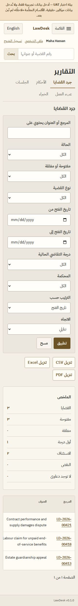</a> |

[Inventory desktop](screenshots/after/inventory-current-en-1366.png) · [Inventory Arabic mobile](screenshots/after/inventory-current-ar-320.png) · [Judgment report Arabic mobile](screenshots/after/judgments-current-ar-375.png). Reports use real backend APIs and permission-gated CSV, Excel and PDF exports. At 320 pixels the many filters create a long section before the table; data rows scroll inside their labelled table region.

## Review decision

Please assess the corrected Dashboard composition and the five report screens in both languages from these images and the [visual gap analysis](PHASE-7-VISUAL-GAP.md). The [complete screen matrix](PHASE-7-ROUTE-COVERAGE.md) records 27 independent routes or states in both languages at 320, 375, 768 and 1366 pixels. Populated judicial workflows, UAT deployment, other browser engines and independent QA are separate gates after visual approval. No Phase 7 merge or deployment is authorized by this gallery alone.
