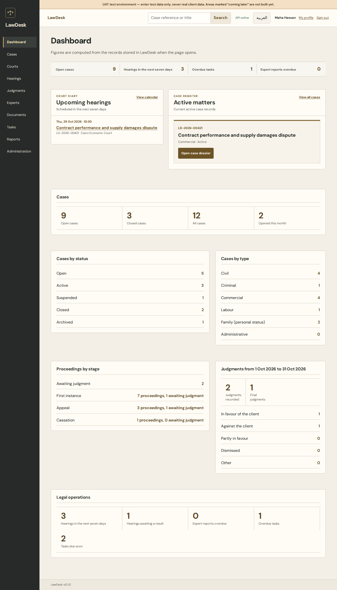

# Modern Chambers — owner visual review

**Approval gate:** review the visual direction before either Phase 7 PR is merged or deployed. These screenshots are actual Chromium renders of LawDesk with fictional, contract-shaped local API responses. They show the interface; they are not UAT data or independent QA acceptance. Open any image for its full resolution.

The [approved Google Stitch project](https://stitch.withgoogle.com/projects/2890116183553293246) has one saved desktop Dashboard screen (`51490074816b4a16a0ebfbc19f35a506`, 2560 × 2048). The first image below is that actual saved screen. Cases, operations, reports and mobile layouts apply its visual system to the real LawDesk v1 workflows; they are interpretations because no approved Stitch screens exist for them.

## 1. Approved source and live Dashboard

| Approved Stitch Dashboard | New LawDesk Dashboard, English desktop |
| --- | --- |
|  |  |

[Approved source full size](reference/stitch-dashboard.png) · [New Dashboard full size](screenshots/after/dashboard-stitch-en-1366.png) · [Arabic mobile Dashboard](screenshots/after/dashboard-stitch-ar-375.png)

The app uses real dashboard figures, scheduled-hearing and active-case APIs with their existing permission gates. Stitch shows trust accounting, print roll and richer case facts that LawDesk v1 cannot supply; those actions were not simulated.

## 2. Cases and dossier

| Cases, English desktop | Cases, Arabic mobile | Case dossier, English desktop |
| --- | --- | --- |
|  |  |  |

[Cases desktop](screenshots/after/cases-current-en-1366.png) · [Cases Arabic mobile](screenshots/after/cases-current-ar-375.png) · [Dossier desktop](screenshots/after/case-details-current-en-1366.png) · [Dossier Arabic mobile](screenshots/after/case-details-current-ar-375.png)

## 3. Legal operations

| Tasks, English desktop | Tasks, Arabic mobile |
| --- | --- |
|  |  |

| Documents, English desktop | Documents, Arabic mobile |
| --- | --- |
|  |  |

[Tasks desktop](screenshots/review/tasks-en-1366.png) · [Tasks Arabic mobile](screenshots/review/tasks-ar-375.png) · [Documents desktop](screenshots/review/documents-en-1366.png) · [Documents Arabic mobile](screenshots/review/documents-ar-375.png). The 16 populated task/document states at 320/375/768/1366 px in both languages had no page errors, document-level overflow or axe WCAG 2/2.1 A/AA violations; see [results](screenshots/review/operations-matrix.json).

## 4. Reports

| Case inventory, English desktop | Case inventory, Arabic mobile |
| --- | --- |
|  |  |

[Inventory desktop](screenshots/after/inventory-current-en-1366.png) · [Inventory Arabic mobile](screenshots/after/inventory-current-ar-320.png) · [Judgment report Arabic mobile](screenshots/after/judgments-current-ar-375.png). Reports use real backend APIs and permission-gated CSV, Excel and PDF exports. At 320 pixels the many filters create a long section before the table; data rows scroll inside their labelled table region.

## Review decision

Please assess the identity, information density, case hierarchy, report readability and Arabic/mobile behavior from these images and the [visual gap analysis](PHASE-7-VISUAL-GAP.md). The [complete screen matrix](PHASE-7-ROUTE-COVERAGE.md) records 27 independent routes or states in both languages at 320, 375, 768 and 1366 pixels. Populated judicial workflows, UAT deployment, other browser engines and independent QA are separate gates after visual approval. No Phase 7 merge or deployment is authorized by this gallery alone.
