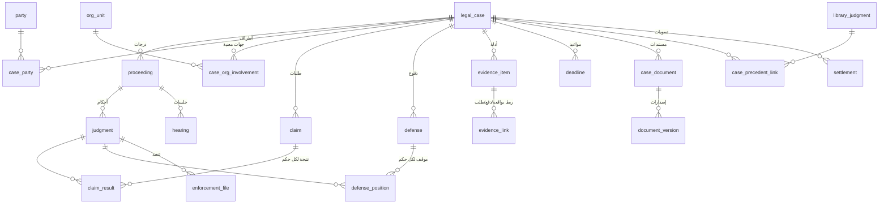

# مخطط البيانات — ملخص محدَّث حسب الوحدة

المصدر: ترحيلات Flyway في `backend/src/main/resources/db/migration` (الجداول أدناه موجودة فعلًا على `develop` عند `2ff4c95`). تصميم الحزمة الأصلي `docs/design/LD-DOC-03-data-model.md` هو **خطة**، وقد اختلف التنفيذ عنها في بضعة مواضع نُبّه إليها في §14.

## 1. اصطلاحات ثابتة

- مفاتيح `uuid` تولّدها القاعدة (`gen_random_uuid()`)، وقفل متفائل `version bigint` على الكيانات القابلة للتعديل.
- أعمدة التدقيق `created_at/created_by` و`updated_at/updated_by`؛ المستخدم `uuid` **بلا مفتاح أجنبي** عمدًا (لا يُحذف المستخدم أبدًا، ويُعطَّل فقط).
- الأحداث `timestamptz` (UTC)، والتواريخ القانونية `date`؛ العرض بتوقيت الكويت.
- لا حذف مادي للسجلات المهنية: الإلغاء حالة أو `removed_at`/`withdrawn_at`. جداول **إلحاقية** يمنع المحرّك تعديلها أو حذفها بمشغّلات: `audit_event`، `claim_revision`، `document_version` و`document_version_content` و`document_deletion_log`، `assistant_query_log`، ومنع **تعديل** `risk_assessment` وعناصره (إصدار جديد لكل تقييم).
- قيم الحالات والأنواع قيود `check` في القاعدة وليست جداول، إلا القوائم المُدارة (D10) في `lookup_value` و`library_classification` و`managed_list_value`.

## 2. الخريطة العامة

## 3. الهوية والصلاحيات والتدقيق (V1، V100–V102، V190)

| الجدول | الغرض |
|--------|-------|
| `app_user` | المستخدم: الاسم، البريد، كلمة المرور المشفرة، `enabled`، `must_change_password`، `locale`، `failed_attempts`/`locked_until`، `credential_version`، `org_unit_id` (وحدته في الشجرة القانونية) |
| `app_role`, `role_permission`, `user_role` | الأدوار (الرمز `code`، `system`) ومنحها لصلاحيات (نص الرمز) وربطها بالمستخدمين |
| `audit_event` | سجل التدقيق (إلحاقي): الفاعل، الإجراء، الهدف، النتيجة، السبب، معرّف الطلب |
| `app_release` | سجل الإصدارات التي بدأت |

## 4. القضية والأطراف والهيكل والوصول (V200–V202، V600–V602)

| الجدول | الأعمدة الجوهرية |
|--------|--------------------|
| `legal_case` | `reference_no` (رقم النظام `LD-<سنة>-<n>`)، `automated_no` (الرقم الآلي القضائي، يدخله المستخدم)، `title`, `case_type`, `subject`, `opened_on`, `status`، `authority_position`, `financial_impact` (YES/NO), `financial_amount`, `claimed_amount`, `primary_member_id`, `alternate_member_id`, `owning_unit_id`, `confidentiality` (NORMAL/RESTRICTED)، `chamber`, `received_on`, `referring_unit_id`, `referred_by`, `facts`, `importance`, `internal_notes` |
| `case_reference_counter` | عدّاد الأرقام الداخلية لكل سنة |
| `case_event` | السجل الزمني للقضية (`type`, `summary`, `occurred_at`) |
| `party`, `case_party`, `case_party_counsel` | الطرف (`kind` PERSON/ORGANIZATION, `national_id` للرقم المدني, `registration_no` لرقم المنشأة, `confidential`, `authority`)، وربطه بالقضية (`role` CLIENT/OPPONENT/OTHER, `side` PLAINTIFF/DEFENDANT)، والمحامون/الوكلاء (LAWYER/AGENT) |
| `org_unit` | شجرتان `tree` = LEGAL / AUTHORITY، `level` SECTOR/DEPARTMENT/SECTION، `parent_id`، `active`، `valid_from/valid_to` — **تبدأ فارغة** |
| `case_org_involvement` | الجهات المعنية بالقضية مع **لقطات الأسماء** `sector_/department_/section_name_snapshot`، `is_primary`، جهة الاتصال، تاريخ الإحالة، `removed_at` |
| `access_scope` | `subject_type` ROLE/USER، `subject_ref`، `scope_type` ALL/ORG_UNIT/OWN_UNIT/CASE_TYPE، `scope_ref`. المزروع: `LEGAL_MANAGER` ← ALL، `SECTION_HEAD` ← OWN_UNIT فقط |
| `case_grant` | منح اطلاع على قضية: `level` VIEW/CONTRIBUTE، `reason`، `expires_at`، `revoked_at/by` — لا حذف |
| `case_duplicate_hint` | قرار المسجِّل بشأن تنبيه التكرار: EXACT/SIMILAR، `decision` DISTINCT/LINKED/DUPLICATE_CONFIRMED |

## 5. المحاكم والدرجات والأحكام (V300–V304، V603، V621)

| الجدول | الأعمدة الجوهرية |
|--------|--------------------|
| `court` | `code`, `name_ar/en`, `level`, `governorate`, `active` |
| `proceeding` | `case_id`, `stage` (FIRST_INSTANCE, APPEAL, CASSATION, CONSTITUTIONAL, ENFORCEMENT, GRIEVANCE)، `court_id`, **`court_case_number`/`court_case_year` (رقم القضية في المحكمة، مستقل لكل درجة)**, `filing_date`, `parent_proceeding_id`, `chamber` |
| `judgment` | `proceeding_id`, `judgment_date`, `outcome`, `summary`, `final`، والموسَّع: `chamber`, `judgment_type_id`/`nature_id` (إلى `lookup_value`), `operative_text`, `reasons`, `costs_amount`, `lawyer_fees_amount`, `appealable`, `notified_on`, `judgment_status`, `copy_document_id` |
| `special_decision` | القرارات الخاصة: `decision_type`, `decision_date`, `effect`, `judgment_id` |

## 6. الطلبات والدفوع والوقائع والأدلة (V620–V623)

| الجدول | الأعمدة الجوهرية |
|--------|--------------------|
| `claim` | `case_id`, `seq` (تسلسل داخل القضية)، `text`, `kind`, `submitted_by_party_id`, `submitted_on`, `stage_id`, `source_document_id`, `status` |
| `claim_revision` | لقطة كاملة لكل تعديل: `rev`, الحقول، `reason`, `changed_by/at` (إلحاقي) |
| `claim_result` | `judgment_id`, `claim_id` (فريد معًا)، `result` (12 قيمة)، `operative`, `reasons`, `awarded_amount` — **نتيجة كل طلب في كل حكم** |
| `defense`, `defense_assertion`, `defense_position` | الدفع؛ التمسك به في كل درجة `(defense, proceeding)`؛ موقف المحكمة منه في كل حكم `(defense, judgment)` — مشغّلات تضمن أن الطرفين من القضية نفسها |
| `defense_template` | مكتبة صياغات الدفوع (DRAFT/REVIEWED/APPROVED) |
| `case_fact`, `evidence_item`, `evidence_link`, `gap_followup` | الوقائع؛ الأدلة (`document_id` مستند من القضية، `role`, `importance`, `submitted_to_court`…)؛ ربط الدليل بواقعة أو دفع أو طلب؛ ربط النواقص بمهمة (`task_id`) أو بطلب إفادة (`info_request_id` بلا مفتاح أجنبي) |
| `lookup_value`, `lookup_value_history` | قوائم معيارية `list_code`, `origin` DOCUMENT/PROPOSED, `approved_by/at`, `active` مع تاريخ كل تعديل؛ المزروع خمس قيم **PROPOSED** (أنواع وطبائع الأحكام) |

## 7. الجلسات والخبراء والمهام والتقويم (V400–V408، V660، V720–V721)

| الجدول | ملاحظة |
|--------|---------|
| `hearing` | `proceeding_id`, `hearing_date/time`, `status` (SCHEDULED/HELD/ADJOURNED/CANCELLED)، `adjourned_from_id` (سلسلة التأجيل)، `kind`, `responsible_member_id`, `no_next_date`, `no_next_date_reason`, `follow_up_flag` وحقول المحضر |
| `expert`, `expert_referral`, `expert_session` | سجل الخبراء وإحالاتهم وجلساتهم |
| `task`, `task_history`, `task_status_map` | المهمة بحالاتها السبع و`delay_reason` و`status_before_late`؛ سجل التغييرات؛ جدول مطابقة الحالات القديمة (للرجوع) |
| `calendar_date` | المواعيد اليدوية فقط؛ **بقية التقويم مشتق** من الجلسات والمهام والخبراء وطلبات الإفادة والمواعيد القانونية دون ازدواج |
| `notification`, `notification_preference` | تنبيهات داخلية: `user_id`, `type`, `record_ref`, `dedupe_key` فريد، `read_at`؛ وتفضيلات التعطيل (غياب الصف = مفعّل) |
| `case_note` | الملاحظات القانونية |

## 8. طلبات الإفادة والمخاطر والارتباط (V661–V663)

`info_request` (الرقم `request_no` `IR-<سنة>-<n>`, `unit_id` + `unit_name_snapshot`, الحالات DRAFT…CLOSED, `due_on`)، `info_reply` (`completeness` PARTIAL/INCOMPLETE/COMPLETE, `document_id`)، `info_follow_up` (REMINDER/RE_ADDRESS/ESCALATION)؛ `risk_assessment` (`version_no`, `level`, `potential_loss`), `risk_assessment_element` (عشرة عناصر بتقدير ولو «غير مقيّم»), `risk_remediation`؛ `case_link` (`kind`, `status`, القرار والمستند).

## 9. المواعيد (V680–V681) — الجداول المرجعية فارغة

`deadline` (المصدر `source_type/source_id/source_text`, `starts_on`, `period_days`, `due_on`, `rule_id`, `calculation` (حساب مخزن), `status` OPEN/COMPLETED/MISSED, `proof_document_id`, **`calc_status` MANUAL/PROPOSED/APPROVED**, `approved_by/at`)، `deadline_rule` و`official_holiday` (DRAFT/APPROVED/RETIRED, **مصدر قانوني إلزامي**)، `deadline_reminder_setting` (صف واحد على الأكثر، `lead_days`). **لا صفوف في الثلاثة بعد الترحيل** (يختبرها `theApplicationShipsNoRuleNoHolidayAndNoReminderSetting`).

## 10. المستندات والأرشيف والمذكرات والتنفيذ (V403، V700–V705)

| الجدول | ملاحظة |
|--------|---------|
| `case_document` (+`case_document_content`, `case_document_quota`) | المستند الحالي: العنوان، الاسم، النوع، الحجم، `sha256`، `category_id`, `proceeding_id`, `current_version_no`, `withdrawn_*`. الملفات `bytea` داخل PostgreSQL |
| `document_version` (+`document_version_content`) | كل إصدار محفوظ ومحمي من التعديل والحذف؛ لكل مستند قائم قبل V701 إصدار 1 بنفس المحتوى والبيانات الوصفية |
| `document_link`, `document_text` | ربط مستند بطلب/دفع/جلسة/حكم/مهمة من القضية نفسها؛ النص المستخرج `status` (EXTRACTED/OCR_DONE/OCR_UNAVAILABLE/…) و`search_text` المطبَّع |
| `document_deletion_log` | سجل الحذف النهائي بلا محتوى |
| `archive_setting`, `archive_format` | الحدود (10 ميغابايت، 100 مستند/قضية، 20 إصدارًا، 50 صفحة OCR، 2,000,000 حرف) وستة صيغ مقبولة — **افتراضات تنتظر اعتماد المالك** |
| `legal_document`, `legal_document_event` | المذكرات والمراسلات: `status` DRAFT/IN_REVIEW/APPROVED/SENT/ARCHIVED, `sent_recorded` (تسجيل يدوي) و`sent_via_integration` (تمنع القاعدة القيمة true) |
| `enforcement_file`, `enforcement_action` | ملف تنفيذ لكل حكم: `amount_required`, `status`, `due_on`, الإجراءات بأنواعها |

## 11. المكتبة والتسويات والتكليفات والنماذج (V640، V740–V745)

`library_judgment` (+ `search_vector` و`trigrams` مولَّدان), `library_principle`, `library_judgment_relation` (APPEALED/UPHELD/MODIFIED/OVERTURNED/LATER/DEPARTED_FROM بمصدر), `library_classification` + `library_judgment_class`, `case_precedent_link`؛ `managed_list_value` (SETTLEMENT_KIND, DIRECTIVE_KIND, TEMPLATE_KIND)؛ `settlement` (+`settlement_document`, `settlement_history`)؛ `directive` (`directive_no` `DIR-<سنة>-<n>`)؛ `form_template` و`form_template_version` (DRAFT/REVIEWED/APPROVED).

## 12. المساعد (V780)

`ai_provider_config` (**فارغ**, ولا مسار في التطبيق يكتب فيه)، `assistant_session` (الوضع الوحيد المسموح `NON_PRODUCTION_TEST`)، `assistant_output` (`is_final` مقيّد بـfalse، حالات DRAFT/USER_APPROVED/DISCARDED)، `assistant_query_log` (إلحاقي، السؤال حتى 500 حرف، النتيجة ANSWERED/INSUFFICIENT_SOURCES/DENIED_*/FAILED، المصادر دون نصوص).

## 13. الحقول المالية وفصلها (القرار D5)

كل مبلغ `numeric(15,3)` بالدينار الكويتي، **عمود مستقل لا يُجمع ولا يُشتق من غيره**، ويخرج نصًا بثلاث منازل في JSON. المبالغ الخمسة المعتمدة:

| المبلغ (D5) | الجدول.العمود | ملاحظة |
|-------------|----------------|---------|
| الأثر المالي | `legal_case.financial_amount` (مع `financial_impact` YES/NO) | قيد قاعدة: YES ← مبلغ موجب؛ NO ← بلا مبلغ |
| المطالب به | `legal_case.claimed_amount` | اختياري ≥ 0 |
| المحكوم به | `claim_result.awarded_amount` | لكل طلب في كل حكم؛ لا استبدال بين الأحكام |
| قيمة التسوية | `settlement.settlement_amount` | لا يُكتب في سجل التدقيق |
| الخسارة المحتملة | `risk_assessment.potential_loss` | لكل إصدار تقييم |

مبالغ أخرى ليست من الخمسة ولا تُخلط بها: `judgment.costs_amount` (المصاريف) و`judgment.lawyer_fees_amount` (أتعاب المحاماة) و`enforcement_file.amount_required` (المطلوب تنفيذه). في التقارير: كل قضية أو طلب أو تقييم يُعدّ مرة واحدة (الطلب المفصول في درجتين يُحتسب بنتيجته الأخيرة)، وفي Excel رقم بتنسيق `#,##0.000`.

## 14. بيانات مزروعة وما يبدأ فارغًا

- **مزروع:** الأدوار الثلاثة الأولى (V100) والأربعة الجديدة (V600) ومنح صلاحياتها؛ صفا `access_scope` (انظر §4)؛ `archive_setting`/`archive_format`؛ خمس قيم `lookup_value` بصفة PROPOSED؛ ثماني قيم `DOCUMENT_CATEGORY` من الوثيقة (+ «غير ذلك» مقترحة)؛ من نص المصدر فقط: أنواع الطلبات الستة وأنواع الدفوع الأربعة والنتائج الاثنتا عشرة في `library_classification`؛ أنواع التسوية والتكليف والنماذج في `managed_list_value`.
- **فارغ عمدًا:** `org_unit`, `deadline_rule`, `official_holiday`, `deadline_reminder_setting`, `library_judgment`, `form_template`, `ai_provider_config`، وكل بيانات القضايا.
- **اختلافات عن تصميم LD-DOC-03:** لا `calendar_event` ولا `document_category` ولا `party_counsel` (الأسماء الفعلية `case_party_counsel`)؛ الرقم المدني/المنشأة في `party.national_id`/`party.registration_no`؛ `judgment.appeal_deadline_id` **لم يُضَف** (المواعيد المترتبة على حكم هي `deadline.source_type = 'JUDGMENT'`)؛ `defense_precedent` **غير مبني**.
